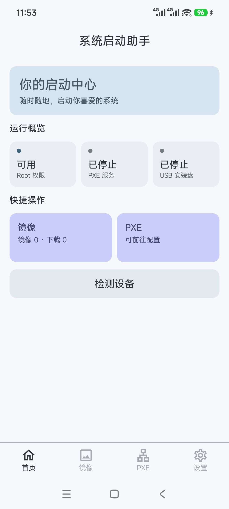
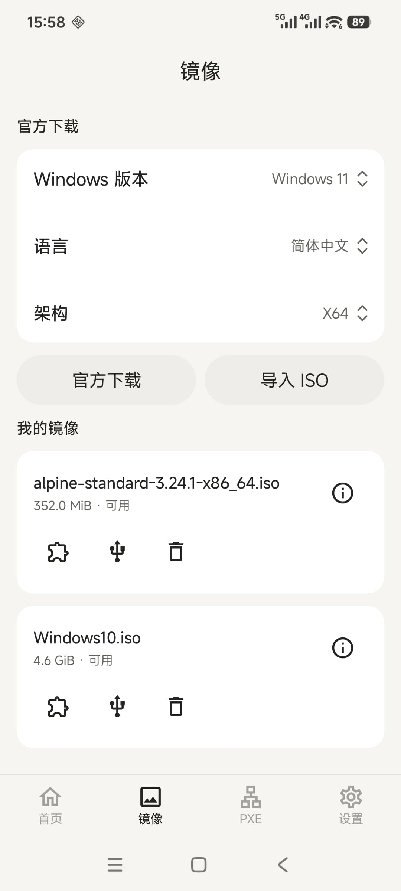
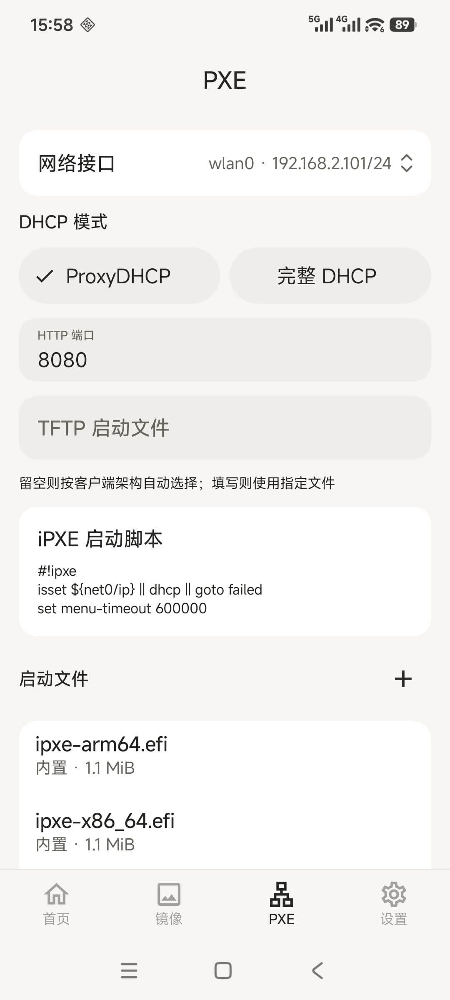

# 系统启动助手（NetBoot）

简体中文 | [English](README.en.md)

让已获 Root 权限的 Android 手机提供 **PXE 网络启动**或**只读 USB 启动盘**，
并支持微软官方 Windows ISO 下载、本地镜像导入和断点续传。

## 使用前提

> 临时root工具 [GhostLock-App](https://github.com/YuKongA/ghostlock-app/blob/main/README_ZH.md) ， [DirtyFrag](https://github.com/mitschud/DirtyFrag)

- Android 8.0 及以上，已在 Root 管理器中授权本应用使用 `su`。应用启动时自动检测现有权限，不安装或修补 Root。
- PXE：手机和电脑接入同一局域网，网络允许设备互访；电脑支持网络启动。
- USB：使用数据线连接电脑；手机内核和 USB 配置需支持添加存储功能。

## PXE 网络启动

1. 打开「PXE」，选择网络接口。家庭网络使用 **ProxyDHCP**；完整 DHCP 仅用于隔离网络。
2. 启动文件留空即可按电脑架构自动选择，也可导入文件并配置 iPXE 脚本。
3. 点击「启动 PXE」，在电脑启动菜单中选择网络启动；用完在应用中停止服务。

默认菜单需要联网获取安装资源。「镜像」页的 ISO 不会自动作为 PXE 安装源；修改运行配置后需重启服务。

## 镜像与 USB 启动盘

1. 在「镜像」页下载或导入 ISO，等待状态变为「可用」。
2. 用数据线连接电脑，点击镜像的 USB 图标并选择「启用」。需要制作时会显示进度，可取消，原始镜像不变。
3. 在电脑启动菜单中选择手机提供的只读磁盘或光驱。
4. 用完先在应用中「停止 USB 启动」，待恢复后再拔线；恢复失败时先重试，仍失败则重启手机。

使用期间请勿切换 USB 模式，文件传输和 USB 调试可能暂时断开。实际兼容性取决于镜像、电脑固件和手机驱动。

### 可选：携带 Windows 驱动

点击镜像的「携带驱动」图标，选择包含完整 INF 驱动包的 ZIP 或文件夹，即可将驱动加入 Windows／WinPE USB 启动介质，无需电脑联网。
Windows 安装程序可自动发现，也可通过「加载驱动」浏览 `$WinPEDriver$` 文件夹；独立 WinPE 需手动加载。

## 预览

---

开发规范见 [AGENTS.md](AGENTS.md)，第三方许可见 [NOTICES.md](NOTICES.md)。
